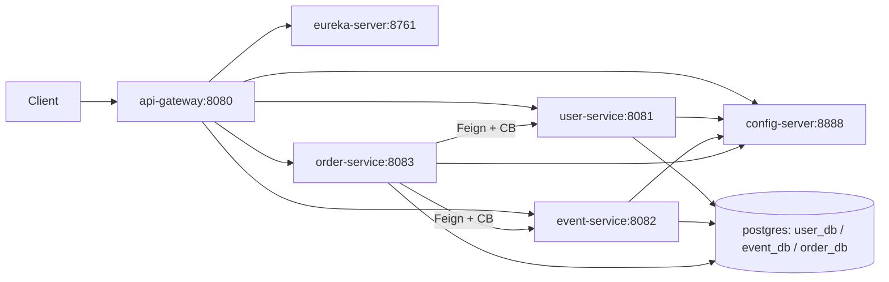

# Лабораторная работа №2. Высокопроизводительные системы. Микросервисная информационная система для покупки/продажи билетов на события

## Архитектура




Перед запуском создайте локальный файл окружения:

```powershell
Copy-Item .env.example .env
```

## Запуск стека (Docker Compose)

Нужен Docker Desktop. Сборка и подъём всего стенда:

```powershell
docker compose up --build
```

Остановка:

```powershell
docker compose down
```

### Порты

| Сервис | Доступ с хоста |
| --- | --- |
| API Gateway | `http://localhost:8080` — внешняя точка входа для API |
| Eureka Dashboard | `http://localhost:8761` — список зарегистрированных сервисов |
| Config Server, postgres, user/event/order | только внутри сети `poster-net` (`expose`) |

Один контейнер `postgres`, логическое разделение — базы `user_db`, `event_db`, `order_db`.  
У каждого сервиса свой `Dockerfile`: копирует локальный Gradle из `gradle/wrapper/` и собирает свой модуль.

`JAVA_OPTS` из `docker-compose.yml` применяются через `ENTRYPOINT`.  
Готовность — healthcheck `/actuator/health`, зависимости ждут `service_healthy`.

JDBC/R2DBC URL и прочие настройки — в `config-repo/{service}/application.yml`;  
в compose для приложений передаются `JAVA_OPTS`, `DB_ADMIN`, `ADMIN_PASSWORD`.

## Маршрутизация через API Gateway

Внешняя точка входа: `http://localhost:8080`.

| Путь | Сервис |
| --- | --- |
| `/api/users/**`, `/api/notifications/**` | `user-service` |
| `/api/events/**`, `/api/registrations/**`, `/api/ticket-types/**`, `/api/ticket-waitlist/**`, `/api/tags/**` | `event-service` |
| `/api/orders/**`, `/api/tickets/**` | `order-service` |

Gateway находит экземпляры сервисов через Eureka. Для каждого запроса он сохраняет
переданный `X-Request-Id` или создаёт новый и пишет начало и окончание запроса в лог.

## Внутренние контракты Order Service

`order-service` ходит к зависимостям через Feign (пути `/internal/**` **не** публикуются на gateway):

- OpenFeign → `user-service`: `GET /internal/users/{id}` (блокирующий клиент + `boundedElastic`);
- Reactive Feign → `event-service`: `GET /internal/events/{id}`, `POST/DELETE .../reservations` (возвращает `Mono`, без `boundedElastic`).

Общие DTO — в `shared-contracts`. Feign **не** генерирует серверные контроллеры:
на стороне `event-service` / `user-service` нужны обычные `@RestController` (`Internal*`).
Вызовы защищены `CircuitBreaker` + `Retry`; при недоступности зависимости — HTTP 503.

## Транзакции при создании/отмене заказа

1. **Локальная JPA-транзакция** в `order-service` сохраняет `Order` + `OrderItem` + `Ticket`
   атомарно: либо вся агрегация заказа пишется, либо ничего.
2. **Согласованность с `event-service`**: перед записью заказа билеты резервируются через Feign;
   если локальное сохранение падает, выполняется компенсация `cancelReservation`.
   При отмене заказа сначала снимается резерв, затем заказ переводится в `CANCELLED`.

Так разделяются границы: локальная БД заказа — через `@Transactional`, межсервисный
ресурс — через reserve/compensate (saga-lite).

## OpenAPI / Swagger

Единая интерактивная документация доступна через API Gateway:

- Swagger UI: `http://localhost:8080/swagger-ui.html`
- Спеки сервисов: `/v3/api-docs/user-service`, `/v3/api-docs/event-service`, `/v3/api-docs/order-service`

В UI можно переключать сервисы в выпадающем списке. `Try it out` ходит через gateway (`localhost:8080`).

## Проверка

Локальные тесты (нужен Docker Desktop для Testcontainers):

```powershell
.\gradlew.bat test
```

После `docker compose up --build` можно проверить:

- Eureka UI: сервисы зарегистрированы (`http://localhost:8761`);
- health: `http://localhost:8080/actuator/health`;
- Swagger: `http://localhost:8080/swagger-ui.html`.

Пошаговый ручной сценарий (пагинация, infinite scroll, CRUD, заказ):  
[docs/swagger-manual-test.md](docs/swagger-manual-test.md).

Если БД уже была создана до seed-миграций, пересоздайте volumes:

```powershell
docker compose down -v
docker compose up --build
```
