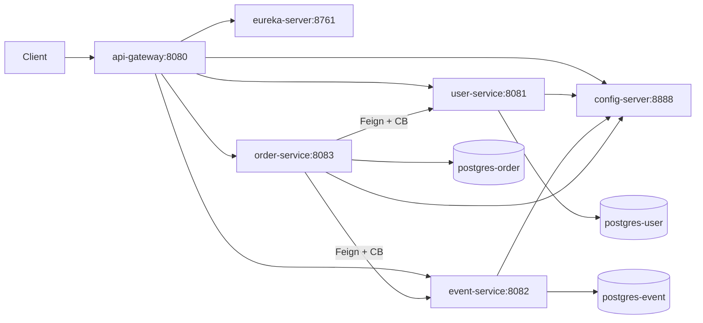
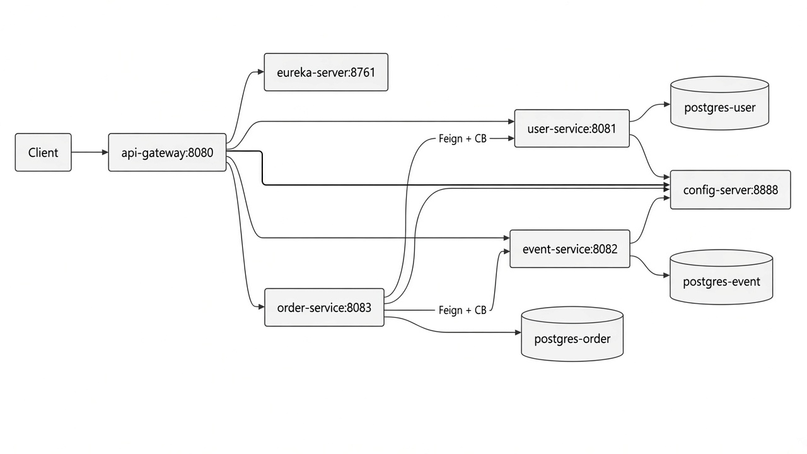

# Лабораторная работа №2. Высокопроизводительные системы. Микросервисная информационная система для покупки/продажи билетов на события

## Архитектура





Перед запуском создайте локальный файл окружения:

```powershell
Copy-Item .env.example .env
```

## Запуск стека (Docker Compose)

Нужен Docker Desktop. Сборка и подъём всего стенда:

```powershell
docker compose up --build
```

Остановка:

```powershell
docker compose down
```

### Порты

| Сервис | URL / порт |
| --- | --- |
| API Gateway | `http://localhost:8080` |
| Eureka Dashboard | `http://localhost:8761` |
| Config Server | `http://localhost:8888` |
| user-service | `http://localhost:8081` |
| event-service | `http://localhost:8082` |
| order-service | `http://localhost:8083` |
| Postgres (user / event / order) | `5433` / `5434` / `5435` |

`JAVA_OPTS` из `docker-compose.yml` (лимиты heap) применяются через `ENTRYPOINT` в Dockerfiles.  
Готовность — healthcheck `/actuator/health`, зависимости ждут `service_healthy`.

Отдельная секция `networks:` не объявлена: Compose сам создаёт одну default-сеть проекта, в ней DNS-имена сервисов (`eureka-server`, `postgres-user`, …) резолвятся автоматически. Явная сеть понадобилась бы только для изоляции или external-сети.

Хосты Eureka/Config и JDBC/R2DBC URL уже прописаны в `*/src/main/resources/application.properties` и `config-repo`; в compose для приложений остаются только `JAVA_OPTS` и `POSTGRES_USER`/`POSTGRES_PASSWORD` (подставляются в `${POSTGRES_*}` из config-repo).

## Маршрутизация через API Gateway

Внешняя точка входа: `http://localhost:8080`.

| Путь | Сервис |
| --- | --- |
| `/api/users/**`, `/api/notifications/**` | `user-service` |
| `/api/events/**`, `/api/registrations/**`, `/api/ticket-types/**`, `/api/ticket-waitlist/**`, `/api/tags/**` | `event-service` |
| `/api/orders/**`, `/api/tickets/**` | `order-service` |

Gateway находит экземпляры сервисов через Eureka. Для каждого запроса он сохраняет
переданный `X-Request-Id` или создаёт новый и пишет начало и окончание запроса в лог.

## Внутренние контракты Order Service

`order-service` обращается к другим сервисам через OpenFeign:

- `GET /internal/users/{id}` — получить пользователя;
- `GET /internal/events/{id}` — получить краткую информацию о мероприятии;
- `POST /internal/events/reservations` — зарезервировать билеты;
- `DELETE /internal/events/reservations/{reservationId}` — отменить резерв.

Общие DTO лежат в модуле `shared-contracts`. Feign является блокирующим, поэтому
его вызовы выполняются на планировщике Reactor `boundedElastic`. Вызовы защищены
`CircuitBreaker` и `Retry`; при недоступности зависимого сервиса наружу возвращается
HTTP 503 с понятным описанием ошибки.

## Транзакции при создании/отмене заказа

1. **Локальная JPA-транзакция** в `order-service` сохраняет `Order` + `OrderItem` + `Ticket`
   атомарно: либо вся агрегация заказа пишется, либо ничего.
2. **Согласованность с `event-service`**: перед записью заказа билеты резервируются через Feign;
   если локальное сохранение падает, выполняется компенсация `cancelReservation`.
   При отмене заказа сначала снимается резерв, затем заказ переводится в `CANCELLED`.

Так разделяются границы: локальная БД заказа — через `@Transactional`, межсервисный
ресурс — через reserve/compensate (saga-lite).

## OpenAPI / Swagger

Единая интерактивная документация доступна через API Gateway:

- Swagger UI: `http://localhost:8080/swagger-ui.html`
- Спеки сервисов: `/v3/api-docs/user-service`, `/v3/api-docs/event-service`, `/v3/api-docs/order-service`

В UI можно переключать сервисы в выпадающем списке. `Try it out` ходит через gateway (`localhost:8080`).

## Проверка

Локальные тесты (нужен Docker Desktop для Testcontainers):

```powershell
.\gradlew.bat test
```

После `docker compose up --build` можно проверить:

- Eureka UI: сервисы зарегистрированы;
- health: `http://localhost:8080/actuator/health`;
- Swagger: `http://localhost:8080/swagger-ui.html`.
